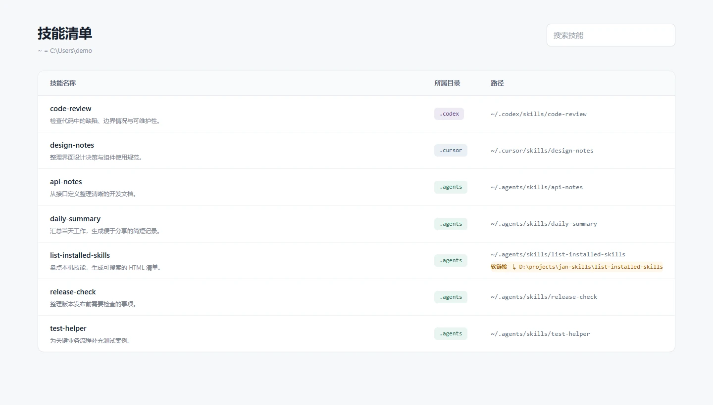

# Jan Skills

实用的 AI Agent 技能集合。每个技能放在独立文件夹中，可以单独下载和安装。

## 技能列表

| 技能 | 用途 |
| --- | --- |
| [list-installed-skills](list-installed-skills/SKILL.md) | 扫描本机技能目录，生成可搜索的 HTML 清单，展示描述、安装位置和软链接目标。 |

## 效果预览



截图使用虚构的示例技能和路径，不代表实际安装清单。也可以下载 [示例 HTML](docs/preview.html) 后在浏览器中打开。

## 环境要求

- Python 3.8 或更高版本；脚本仅使用标准库，无需安装第三方 Python 包。
- 运行技能的 Agent 需要能够读取本机文件并执行 Python；也可以直接运行脚本。
- 使用现代浏览器打开生成的 HTML，支持离线搜索。
- 当前已在 Windows / Python 3.12 环境运行验证；macOS 和 Linux 尚未验证。

## 安装

下载本仓库 ZIP 并解压，或将仓库克隆到本地。**复制整个 `list-installed-skills` 文件夹**，不要只复制 `SKILL.md`，脚本和 HTML 模板也需要一起安装。

例如，将技能复制到用户级共享技能目录：

```text
~/.agents/skills/list-installed-skills/
├── SKILL.md
├── scripts/
│   ├── scan_skills.py
│   └── render_inventory.py
└── assets/
    └── inventory.html
```

`~` 表示用户主目录。Windows 示例为 `C:\Users\你的用户名\.agents\skills`。其他 Agent 请使用其支持的技能目录；能被本技能扫描，不等于该工具已经验证支持运行本技能。

如果要持续修改技能，可以使用软链接，避免每次修改后重新复制。以下命令在仓库根目录执行，且目标安装目录必须尚不存在。

Windows PowerShell：

```powershell
$skillSource = (Resolve-Path .\list-installed-skills).Path
$skillParent = Join-Path $HOME '.agents\skills'
New-Item -ItemType Directory -Path $skillParent -Force | Out-Null
New-Item -ItemType SymbolicLink -Path (Join-Path $skillParent 'list-installed-skills') -Target $skillSource
```

Windows 创建软链接可能需要开发者模式或管理员权限；不方便启用时，直接复制整个文件夹即可。

macOS / Linux（安装示例，尚未实际验证）：

```sh
mkdir -p "$HOME/.agents/skills"
ln -s "$PWD/list-installed-skills" "$HOME/.agents/skills/list-installed-skills"
```

## 使用

安装后，向 Agent 发出请求：

```text
使用 list-installed-skills 列出我安装的技能，并生成 HTML 清单。
```

也可以让 Agent 读取本地 `list-installed-skills/SKILL.md`，按其中的流程运行。不同工具的技能发现和调用方式可能不同。

无需 Agent，在仓库根目录直接运行：

```sh
python list-installed-skills/scripts/render_inventory.py --project . --output output/installed-skills.html
```

打开生成的 `output/installed-skills.html` 即可。Windows 上也可以将 `python` 替换为 `py -3`，macOS / Linux 通常使用 `python3`。

追加自定义技能根目录：

```sh
python list-installed-skills/scripts/render_inventory.py --project . --root "D:/shared-skills" --output output/installed-skills.html
```

`--root` 可以重复指定。需要原始 JSON 清单时：

```sh
python list-installed-skills/scripts/scan_skills.py --project .
```

## 扫描与展示规则

- 检查用户主目录、指定项目及其祖先目录中的常见技能位置，包括 `.agents`、`.codex`、`.cursor` 等；同时检查隐藏工具目录下的 `skills` 子目录。
- 支持 `CODEX_HOME` 和 `XDG_CONFIG_HOME`；不遍历整盘或自动扫描其他项目。
- 以 `SKILL.md` 为识别依据，排除内置技能目录、插件目录、缓存、回收站和依赖目录。
- 同名技能位于不同目录时分别保留，软链接显示安装入口和实际目标。
- 按所属目录排序，`.agents` 放在最后；名称下展示描述，搜索支持名称、描述和路径。
- 描述来自 frontmatter 的常见字符串格式；内置读取器不是完整 YAML 解析器，不支持所有高级 YAML 语法。
- 页面是扫描时的快照；刷新浏览器不会重新扫描，再次运行命令才会更新。

“手动安装”指用户或项目目录中发现的非内置技能候选，包含通过管理工具、命令或复制安装的技能；仅凭目录无法确认安装者或安装方式。

## 本地数据

脚本读取本机技能文件并写出 HTML，不联网，不上传清单，也不会安装、删除或修改被扫描的技能。Agent 自身如何处理读取到的数据，取决于所用工具的配置。

报告包含本机路径和技能描述，分享前请检查内容。`output/` 已被忽略，不应作为源码提交。

## 项目结构

```text
jan-skills/
├── README.md
├── LICENSE
├── .gitignore
├── docs/
│   ├── preview.html
│   └── images/list-installed-skills.webp
└── list-installed-skills/
    ├── SKILL.md
    ├── assets/inventory.html
    └── scripts/
        ├── scan_skills.py
        └── render_inventory.py
```

## 反馈与贡献

欢迎通过 Issues 反馈问题，附上操作系统、Python 版本、复现步骤和报错；分享日志或截图前请隐藏个人路径。新增技能请放到独立文件夹，并更新本页技能列表。

## 许可证

[MIT](LICENSE)。
